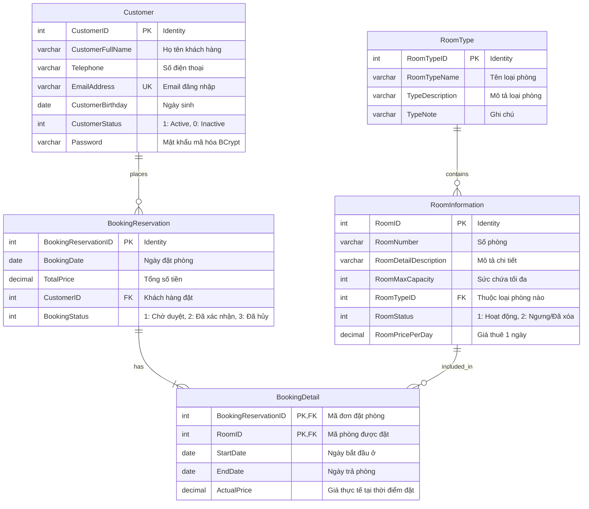
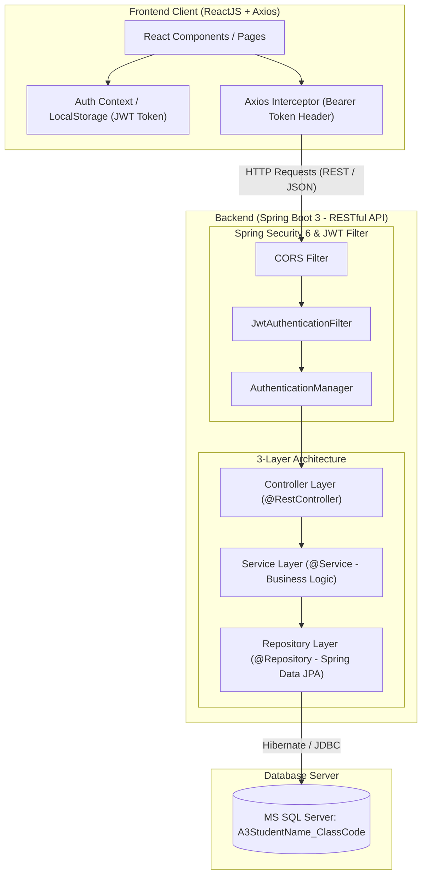
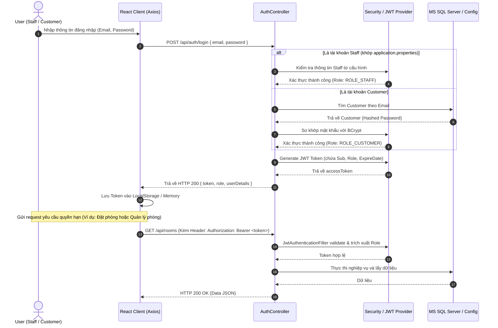
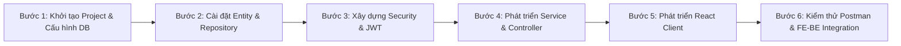

# BÁO CÁO PHÂN TÍCH & THIẾT KẾ KIẾN TRÚC HỆ THỐNG
# ASSIGNMENT 03: SBA301 - SECURING REST SERVICES WITH SPRING BOOT
## Hệ Thống Quản Lý Khách Sạn: FUMiniHotelSystem

---

## 1. Giới thiệu tổng quan (Project Overview)
**FUMiniHotelSystem** là ứng dụng quản lý khách sạn mini được xây dựng theo mô hình Client-Server phân tách:
- **Backend (BE)**: Xây dựng RESTful API bằng **Spring Boot 3**, sử dụng **Spring Data JPA** để làm việc với **MS SQL Server**, bảo mật bằng **Spring Security** và **JSON Web Token (JWT)** theo kiến trúc chuẩn **3-Layer with Repository Architecture**.
- **Frontend (FE)**: Xây dựng bằng **ReactJS**, giao tiếp với RESTful API thông qua thư viện **Axios**, cung cấp giao diện tương tác phân quyền cho Khách vãng lai, Khách hàng (Customer) và Nhân viên (Staff).

Dự án tuân thủ quy chuẩn định danh:
- **Database Name**: `A3StudentName_ClassCode` (Ví dụ: `A3HuyNT_SE1910`)
- **Backend Project**: `A3StudentName_ClassCode` (hoặc thư mục backend)
- **Frontend Project**: `A3StudentName_ClassCode` (hoặc thư mục frontend)

---

## 2. Phân tích Yêu cầu Bài toán (Requirements Analysis)

### 2.1. Phân quyền và Vai trò người dùng (Roles & Permissions)

| Vai trò (Role) | Cơ chế xác thực | Quyền hạn / Chức năng chính |
| :--- | :--- | :--- |
| **Guest / Anonymous** | Không yêu cầu đăng nhập | - Xem danh sách và thông tin chi tiết phòng khách sạn.<br>- Đăng ký tài khoản Customer mới. |
| **Customer** | Đăng nhập bằng `EmailAddress` & `Password` (JWT Token) | - Quản lý thông tin hồ sơ cá nhân (Profile: xem & cập nhật).<br>- Tạo đơn đặt phòng trực tuyến (Booking Reservation) chứa 1 hoặc nhiều phòng.<br>- Xem lịch sử các đơn đặt phòng của chính mình. |
| **Staff** | Đăng nhập bằng tài khoản cấu hình trong file `application.properties` | - **Quản lý khách hàng**: Xem, thêm, sửa, xóa, tìm kiếm thông tin Customer.<br>- **Quản lý phòng (Room)**: CRUD thông tin phòng và loại phòng.<br>  *Nghiệp vụ đặc thù khi Xóa phòng*: Xem chi tiết mục 2.2.<br>- **Quản lý đơn đặt phòng**: Quản lý các Booking Reservation kèm chi tiết Booking Detail. |

### 2.2. Nghiệp vụ Đặc thù Cần Lưu Ý
1. **Tài khoản Staff lấy từ file cấu hình (`application.properties`)**:
   - Tài khoản Staff (Admin/Staff) không nhất thiết nằm trong bảng `Customer` của cơ sở dữ liệu.
   - Cần cấu hình email/username và mật khẩu mặc định trong `application.properties` (ví dụ: `app.staff.email=staff@fuminihotel.com`, `app.staff.password=...`).
   - Khi đăng nhập với tài khoản này, hệ thống sẽ cấp JWT token mang quyền `ROLE_STAFF`.
2. **Quy tắc Xóa phòng (Room Deletion Rule)**:
   - **Xóa vật lý (Hard Delete)**: Nếu phòng **chưa từng phát sinh giao dịch đặt phòng** (không tồn tại bản ghi trong `BookingDetail`), hệ thống cho phép xóa vĩnh viễn khỏi Database.
   - **Xóa mềm / Chuyển trạng thái (Soft Delete / Status Change)**: Nếu phòng **đã từng tồn tại trong `BookingDetail`**, không được phép xóa vật lý (để bảo toàn toàn vẹn dữ liệu lịch sử hóa đơn), mà chỉ cập nhật trạng thái `RoomStatus` (ví dụ: chuyển từ `1: Active` sang `2: Inactive/Deleted`).
3. **Đặt phòng chứa nhiều phòng (Multi-room Booking)**:
   - Một giao dịch đặt phòng (`BookingReservation`) có thể gồm 1 hoặc nhiều phòng (`BookingDetail`), với khoảng ngày (`StartDate`, `EndDate`) và giá thực tế (`ActualPrice`).
   - Thao tác đặt phòng phải đảm bảo tính toàn vẹn (Transactional ACID).

---

## 3. Thiết kế Cơ sở Dữ liệu (Database Design)

### 3.1. Sơ đồ Quan hệ Thực thể (ERD)



### 3.2. Mối quan hệ giữa các thực thể
- **RoomType (1) - (N) RoomInformation**: Một loại phòng có thể áp dụng cho nhiều phòng. Mỗi phòng chỉ thuộc về duy nhất một loại phòng.
- **Customer (1) - (N) BookingReservation**: Một khách hàng có thể thực hiện nhiều lần đặt phòng qua thời gian.
- **BookingReservation (1) - (N) BookingDetail**: Một đơn đặt phòng có thể đặt một hoặc nhiều phòng khác nhau.
- **RoomInformation (1) - (N) BookingDetail**: Một phòng có thể xuất hiện trong nhiều giao dịch đặt phòng ở các mốc thời gian khác nhau.
- `BookingDetail` sử dụng Composite Key (`BookingReservationID`, `RoomID`) hoặc ID tự tăng kết hợp Unique Constraint trên cặp khóa ngoại này.

---

## 4. Kiến trúc Hệ thống (System Architecture)

### 4.1. Kiến trúc Tổng thể (Fullstack High-Level Architecture)



---

### 4.2. Kiến trúc 3-Layer + Repository Pattern ở Backend

Cấu trúc phân lớp tuân thủ triệt để nguyên tắc **Separation of Concerns (SoC)**:

1. **Controller Layer (Presentation Layer)**:
   - Nhận HTTP Request từ Client (`GET`, `POST`, `PUT`, `DELETE`).
   - Validate dữ liệu đầu vào sử dụng `@Valid` và Jakarta Validation (`@NotBlank`, `@NotNull`, `@Min`, `@Email`).
   - Gọi xuống Service Layer xử lý logic và trả về HTTP Response chuẩn `ResponseEntity<ApiResponse<T>>`.
2. **Service Layer (Business Logic Layer)**:
   - Xử lý toàn bộ logic nghiệp vụ (Kiểm tra trùng lặp email, kiểm tra phòng có trong `BookingDetail` trước khi xóa, tính tổng tiền đơn đặt, quản lý giao dịch `@Transactional`).
   - Chuyển đổi qua lại giữa Entity và DTO (Data Transfer Object) để tránh lộ thực thể JPA ra ngoài.
3. **Repository Layer (Data Access Layer)**:
   - Kế thừa `JpaRepository<Entity, ID>` từ Spring Data JPA.
   - Định nghĩa các custom query (`@Query`, JPQL hoặc Derived Query Methods) để truy vấn nhanh dữ liệu.
4. **Cross-Cutting Concerns (Bảo mật & Xử lý lỗi)**:
   - **Spring Security + JWT**: Kiểm tra token trong Header `Authorization: Bearer <token>`, xác thực danh tính và phân quyền RBAC (`@PreAuthorize("hasRole('STAFF')")`).
   - **Global Exception Handler**: Bắt và xử lý tập trung các lỗi (`@RestControllerAdvice`), trả về JSON format đồng nhất khi xảy ra lỗi validation hoặc lỗi nghiệp vụ.

---

### 4.3. Luồng Xác thực & Phân quyền JWT (Authentication & Authorization Flow)



---

## 5. Hướng Tiếp Cận & Giải Pháp Triển Khai Chi Tiết (Approach & Solutions)

### 5.1. Backend Implementation (Spring Boot 3)

#### A. Cấu hình & Quản lý Phụ thuộc (Dependencies - `pom.xml`)
- `spring-boot-starter-web`: Xây dựng REST API với Spring MVC và nhúng Tomcat.
- `spring-boot-starter-data-jpa`: Tương tác ORM qua Hibernate.
- `spring-boot-starter-security`: Cung cấp bộ lọc bảo mật filter chain.
- `spring-boot-starter-validation`: Hỗ trợ validate dữ liệu đầu vào (`@Valid`).
- `com.microsoft.sqlserver:mssql-jdbc`: Driver kết nối MS SQL Server.
- `io.jsonwebtoken:jjwt-api`, `jjwt-impl`, `jjwt-jackson`: Tạo và giải mã JWT token.
- `lombok`: Giảm thiểu boilerplate code (Getter, Setter, Constructor, Builder).

#### B. Chiến lược Cấu hình Tài khoản Staff từ `application.properties`
Theo yêu cầu đề bài: *"The Staff account will get from application.properties file"*.
- Định nghĩa trong `src/main/resources/application.properties`:
  ```properties
  # Database configuration
  spring.datasource.url=jdbc:sqlserver://localhost:1433;databaseName=A3HuyNT_SE1910;encrypt=true;trustServerCertificate=true;
  spring.datasource.username=sa
  spring.datasource.password=YourPassword123
  spring.jpa.hibernate.ddl-auto=update
  spring.jpa.show-sql=true

  # Staff predefined account
  app.staff.email=staff@fuminihotel.com
  app.staff.password=Staff@123456

  # JWT Secret & Expiration
  app.jwt.secret=404E635266556A586E3272357538782F413F4428472B4B6250645367566B5970
  app.jwt.expiration-ms=86400000
  ```
- **Giải pháp**: Xây dựng một `CustomUserDetailsService` hoặc xử lý tại tầng `AuthenticationService`:
  - Khi user đăng nhập, hệ thống kiểm tra nếu `email.equalsIgnoreCase(staffEmail)`:
    - Kiểm tra mật khẩu trực tiếp (hoặc dùng `PasswordEncoder` so khớp).
    - Cấp `UserDetails` mang quyền `ROLE_STAFF`.
  - Nếu không phải email của Staff, hệ thống sẽ truy vấn bảng `Customer` trong SQL Server:
    - So khớp mật khẩu đã hash với `BCryptPasswordEncoder`.
    - Cấp `UserDetails` mang quyền `ROLE_CUSTOMER`.

#### C. Giải pháp Nghiệp vụ Xóa Phòng (Room Deletion Logic)
```java
@Transactional
public void deleteRoom(Integer roomId) {
    RoomInformation room = roomRepository.findById(roomId)
        .orElseThrow(() -> new ResourceNotFoundException("Room not found with id: " + roomId));

    // Kiểm tra xem phòng đã từng phát sinh trong BookingDetail chưa
    boolean hasBookingHistory = bookingDetailRepository.existsByRoomID(roomId);

    if (hasBookingHistory) {
        // Đã có giao dịch -> Soft delete (chỉ đổi trạng thái)
        room.setRoomStatus(2); // Giả sử 2 = Inactive/Deleted
        roomRepository.save(room);
    } else {
        // Chưa có giao dịch nào -> Hard delete (xóa vĩnh viễn)
        roomRepository.delete(room);
    }
}
```

#### D. Giải pháp Nghiệp vụ Đặt phòng Trực tuyến (Online Booking Transaction)
- Đảm bảo tính nhất quán dữ liệu với `@Transactional`:
  1. Kiểm tra tính hợp lệ của danh sách các phòng được chọn (`RoomStatus == 1`).
  2. Kiểm tra khoảng thời gian đặt phòng (`StartDate` đến `EndDate`) có bị trùng lịch với đơn đặt phòng đã được xác nhận trước đó hay không.
  3. Tạo mới bản ghi `BookingReservation` với `CustomerID` lấy từ Token của user đang đăng nhập.
  4. Lặp qua danh sách phòng, tạo các bản ghi `BookingDetail`, tính toán `ActualPrice` và cập nhật `TotalPrice` cho đơn đặt phòng.
  5. Lưu toàn bộ vào cơ sở dữ liệu.

---

### 5.2. Frontend Implementation (ReactJS + Axios)

#### A. Cấu trúc Dự án React Khuyến nghị
```text
frontend/src/
├── assets/             # Hình ảnh, icons, styles chung
├── components/         # Các component tái sử dụng (Navbar, Footer, Table, Modal)
│   ├── common/
│   └── forms/
├── context/            # AuthContext (quản lý trạng thái login, user, token)
├── routes/             # Cấu hình định tuyến & ProtectedRoute
│   ├── AppRoutes.jsx
│   └── ProtectedRoute.jsx
├── services/           # Tầng gọi API qua Axios
│   ├── api.js          # Cấu hình Axios instance & Request/Response Interceptor
│   ├── authService.js
│   ├── customerService.js
│   ├── roomService.js
│   └── bookingService.js
├── pages/
│   ├── public/         # RoomCatalog, RoomDetail, Login, Register
│   ├── customer/       # CustomerProfile, BookingHistory, CreateBooking
│   └── staff/          # ManageCustomers, ManageRooms, ManageBookings
└── App.jsx
```

#### B. Cấu hình Axios Interceptor tự động đính kèm Token
```javascript
// src/services/api.js
import axios from 'axios';

const api = axios.create({
  baseURL: 'http://localhost:8080/api',
  headers: {
    'Content-Type': 'application/json',
  },
});

// Request Interceptor: Tự động gán JWT Bearer token
api.interceptors.request.use(
  (config) => {
    const token = localStorage.getItem('token');
    if (token) {
      config.headers.Authorization = `Bearer ${token}`;
    }
    return config;
  },
  (error) => Promise.reject(error)
);

// Response Interceptor: Bắt lỗi 401/403 tự động đăng xuất
api.interceptors.response.use(
  (response) => response,
  (error) => {
    if (error.response && (error.response.status === 401 || error.response.status === 403)) {
      // Token hết hạn hoặc không có quyền truy cập
      localStorage.removeItem('token');
      localStorage.removeItem('user');
      window.location.href = '/login';
    }
    return Promise.reject(error);
  }
);

export default api;
```

#### C. Phân quyền Router (Protected Route)
- **Public Route**: Trang danh sách phòng, xem chi tiết phòng, trang Đăng nhập, Đăng ký.
- **Customer Route**: Chỉ cho phép người dùng có `ROLE_CUSTOMER` truy cập (`/my-profile`, `/my-bookings`, `/book-room`).
- **Staff Route**: Chỉ cho phép người dùng có `ROLE_STAFF` truy cập (`/staff/customers`, `/staff/rooms`, `/staff/bookings`).

---

## 6. Đặc tả RESTful API (API Specifications)

### 6.1. Authentication Endpoints (`/api/auth`)
| Method | Endpoint | Yêu cầu quyền | Mô tả |
| :--- | :--- | :--- | :--- |
| `POST` | `/api/auth/login` | Public | Đăng nhập cho cả Staff và Customer, trả về JWT Token. |
| `POST` | `/api/auth/register` | Public | Đăng ký tài khoản mới cho Customer. |

### 6.2. Room Information Endpoints (`/api/rooms`)
| Method | Endpoint | Yêu cầu quyền | Mô tả |
| :--- | :--- | :--- | :--- |
| `GET` | `/api/rooms` | Public | Lấy danh sách tất cả các phòng (hỗ trợ filter, tìm kiếm). |
| `GET` | `/api/rooms/{id}` | Public | Lấy thông tin chi tiết một phòng. |
| `POST` | `/api/rooms` | `STAFF` | Thêm mới phòng. |
| `PUT` | `/api/rooms/{id}` | `STAFF` | Cập nhật thông tin phòng. |
| `DELETE` | `/api/rooms/{id}` | `STAFF` | Xóa phòng (Hard delete nếu chưa có booking, Soft delete nếu đã có). |

### 6.3. Room Type Endpoints (`/api/room-types`)
| Method | Endpoint | Yêu cầu quyền | Mô tả |
| :--- | :--- | :--- | :--- |
| `GET` | `/api/room-types` | Public | Lấy danh sách tất cả loại phòng. |
| `POST` | `/api/room-types` | `STAFF` | Thêm mới loại phòng. |

### 6.4. Customer Management Endpoints (`/api/customers`)
| Method | Endpoint | Yêu cầu quyền | Mô tả |
| :--- | :--- | :--- | :--- |
| `GET` | `/api/customers/profile` | `CUSTOMER` | Xem thông tin hồ sơ của tài khoản đang đăng nhập. |
| `PUT` | `/api/customers/profile` | `CUSTOMER` | Cập nhật thông tin hồ sơ của chính mình. |
| `GET` | `/api/customers` | `STAFF` | Lấy danh sách toàn bộ khách hàng (hỗ trợ tìm kiếm theo tên, email). |
| `GET` | `/api/customers/{id}` | `STAFF` | Lấy thông tin chi tiết một khách hàng. |
| `POST` | `/api/customers` | `STAFF` | Thêm mới khách hàng thủ công. |
| `PUT` | `/api/customers/{id}` | `STAFF` | Cập nhật thông tin khách hàng. |
| `DELETE` | `/api/customers/{id}` | `STAFF` | Khóa hoặc xóa tài khoản khách hàng. |

### 6.5. Booking Reservation Endpoints (`/api/bookings`)
| Method | Endpoint | Yêu cầu quyền | Mô tả |
| :--- | :--- | :--- | :--- |
| `POST` | `/api/bookings` | `CUSTOMER` | Tạo đơn đặt phòng mới (gồm 1 hoặc nhiều phòng). |
| `GET` | `/api/bookings/my-history` | `CUSTOMER` | Xem lịch sử đơn đặt phòng của tài khoản đang đăng nhập. |
| `GET` | `/api/bookings` | `STAFF` | Xem toàn bộ đơn đặt phòng của hệ thống kèm chi tiết. |
| `GET` | `/api/bookings/{id}` | `STAFF`, `CUSTOMER` | Xem chi tiết 1 đơn đặt phòng (Customer chỉ xem đơn của mình). |
| `PUT` | `/api/bookings/{id}/status` | `STAFF` | Cập nhật trạng thái đơn đặt phòng. |

---

## 7. Kế hoạch Triển khai Từng Bước (Implementation Roadmap)



### Chi tiết các bước thực hiện:
1. **Bước 1: Khởi tạo Project & Database**:
   - Sử dụng Spring Initializr tạo project Spring Boot 3 (`A3HuyNT_SE1910`).
   - Cấu hình kết nối MS SQL Server trong `application.properties` với database tên `A3HuyNT_SE1910`.
   - Cấu hình tài khoản Staff và JWT secret key.
2. **Bước 2: Xây dựng Entity JPA & Repository**:
   - Khởi tạo 5 thực thể: `Customer`, `RoomType`, `RoomInformation`, `BookingReservation`, `BookingDetail`.
   - Thiết lập các mối quan hệ `@OneToMany`, `@ManyToOne`, `@JoinColumn` và composite key cho `BookingDetail`.
   - Cấu hình `spring.jpa.hibernate.ddl-auto=update` để Hibernate tự sinh bảng trong SQL Server.
3. **Bước 3: Cấu hình Spring Security 6 & JWT**:
   - Xây dựng `JwtUtils` (tạo token, trích xuất claim, kiểm tra hạn token).
   - Xây dựng `JwtAuthenticationFilter` kế thừa `OncePerRequestFilter`.
   - Cấu hình `SecurityFilterChain` cho phép truy cập Public với `/api/auth/**` và GET `/api/rooms/**`, đồng thời phân quyền chặt chẽ các endpoint còn lại.
   - Xử lý xác thực tài khoản Staff từ `application.properties`.
4. **Bước 4: Phát triển Tầng DTO, Service & Controller**:
   - Viết DTOs và áp dụng validation (`@NotNull`, `@Email`, `@Min`,...).
   - Viết Service xử lý nghiệp vụ xóa phòng (Hard/Soft delete) và đặt nhiều phòng.
   - Viết Controller trả về dữ liệu chuẩn RESTful.
   - Xây dựng `GlobalExceptionHandler` bắt lỗi `MethodArgumentNotValidException`, `ResourceNotFoundException`.
5. **Bước 5: Xây dựng Giao diện ReactJS Client**:
   - Khởi tạo ứng dụng ReactJS bằng Vite hoặc Create React App.
   - Cài đặt Axios, React Router Dom, React Icons / UI Library (TailwindCSS hoặc Bootstrap / Ant Design).
   - Xây dựng `AuthContext` và thiết lập Axios Interceptors tự động gắn Token.
   - Triển khai các màn hình dành riêng cho Staff và Customer theo đúng yêu cầu đề bài.
6. **Bước 6: Kiểm thử & Đóng gói**:
   - Viết kịch bản kiểm thử API trên Postman (Public, Login Staff/Customer, Quản lý phòng, Đặt phòng, Xóa phòng kiểm tra logic).
   - Kiểm thử tương tác mượt mà giữa ReactJS và Backend.
   - Soạn tài liệu hướng dẫn chạy dự án.

---

## 8. Hướng dẫn Chạy Dự án (Quick Start Guide)

### 8.1. Yêu cầu Môi trường (Prerequisites)
- **Java Development Kit (JDK)**: Phiên bản 17 hoặc 21 trở lên.
- **Node.js**: Phiên bản 18 trở lên & npm/yarn.
- **Database Server**: Microsoft SQL Server (2019/2022 hoặc Express Edition).
- **IDE**: IntelliJ IDEA / VS Code / Eclipse.

### 8.2. Khởi chạy Backend (Spring Boot 3)
1. Đảm bảo dịch vụ SQL Server đang chạy và tạo database trống:
   ```sql
   CREATE DATABASE A3HuyNT_SE1910;
   ```
2. Cập nhật thông tin đăng nhập SQL Server trong file `src/main/resources/application.properties`.
3. Mở terminal tại thư mục backend và chạy lệnh:
   ```bash
   ./mvnw clean spring-boot:run
   ```
   *Ứng dụng Backend sẽ chạy tại: `http://localhost:8080`*

### 8.3. Khởi chạy Frontend (ReactJS)
1. Mở terminal tại thư mục frontend và cài đặt thư viện:
   ```bash
   npm install
   ```
2. Khởi chạy ứng dụng:
   ```bash
   npm run dev
   # hoặc npm start
   ```
   *Ứng dụng Frontend sẽ chạy tại: `http://localhost:5173` (hoặc `http://localhost:3000`)*
